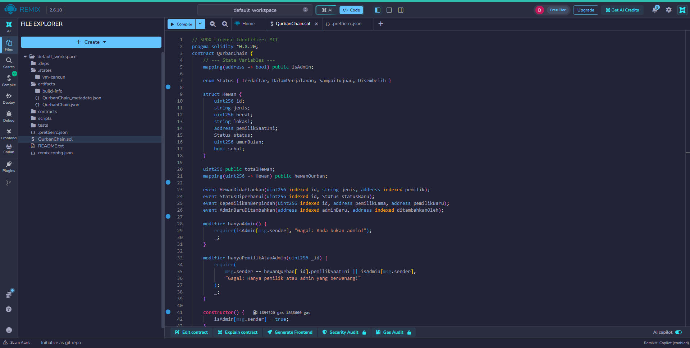

# Revisi UTS Kelompok 4 : Sistem Pelacakan Hewan Qurban

**Mata Kuliah:** Blockchain  
**Proyek:** Revisi UTS Kelompok 4

**Anggota Kelompok:**
1. Moh. Nukhas H [2530801107]
2. Danu Suryana [2530801070]   
3. Moh. Farizul Haq [2530801084]

---

## 1. Tambahkan Validasi Inputan Berat Hewan Qurban
<video controls src="20261102-0606-07.3226950-1.mp4" title="Title"></video>

## 2. Validasi Nama/Jenis Tidak Boleh Kosong
1. Revisi nama/jenis hewan tidak boleh kosong
<video controls src="20261102-0610-02.4772683.mp4" title="Title"></video>

2. Revisi Lokasi hewan tidak boleh kosong 
<video controls src="20261102-0613-26.1315622.mp4" title="Title"></video>

## 3. Tegakkan Syariat Hewan Qurban
1. Hewan Wajib memenuhi syarat minimum qurban
<video controls src="20261102-0616-35.1575796.mp4" title="Title"></video>

2. Hewan Harus Sehat dan Tidak Cacat
<video controls src="20261102-0619-13.2292624.mp4" title="Title"></video>

## 4. Pertahankan Nama Resmi (QurbanChain)

## 5. Revisi FLowchart menjadi bentuk diagram
